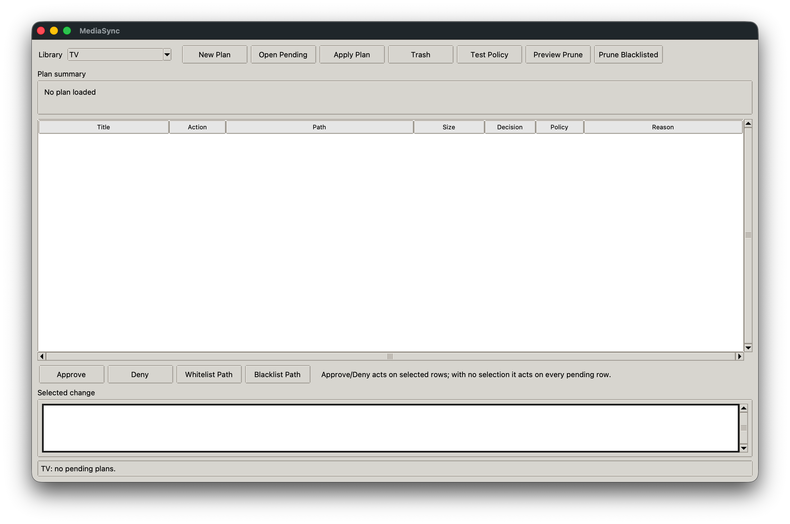
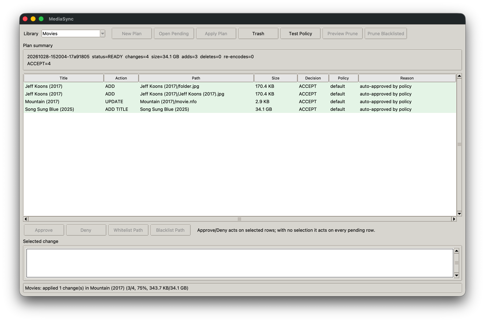
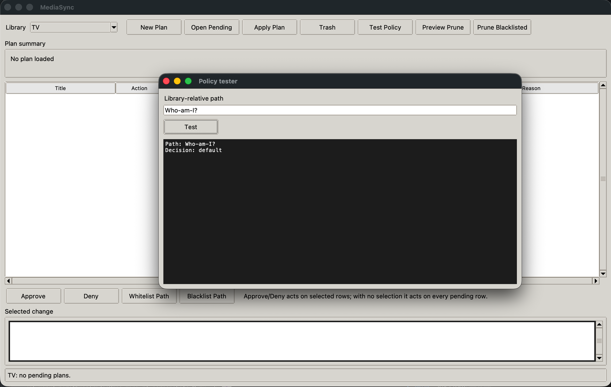
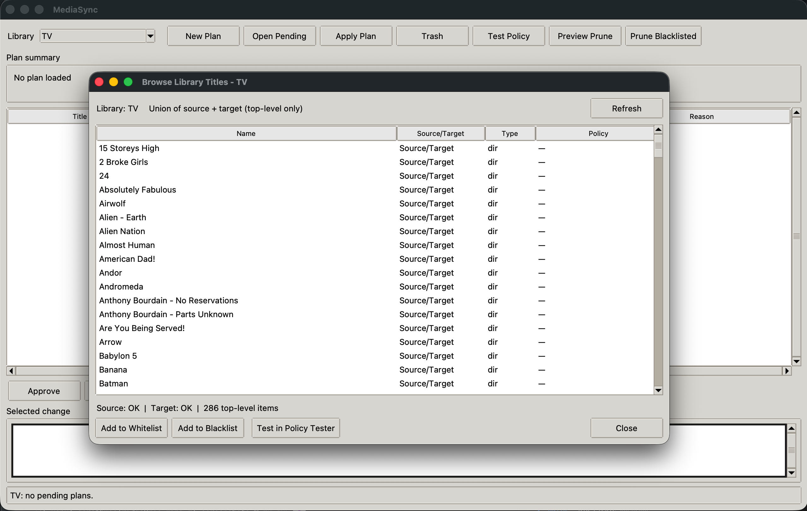
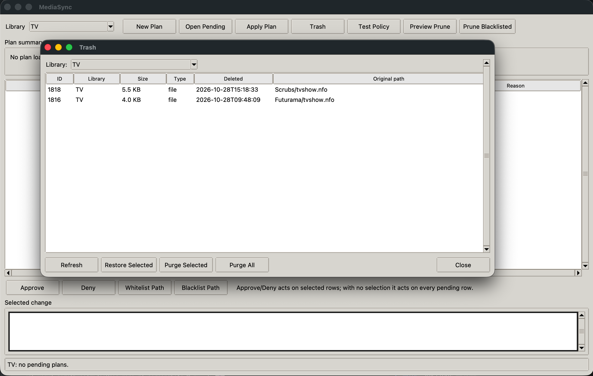
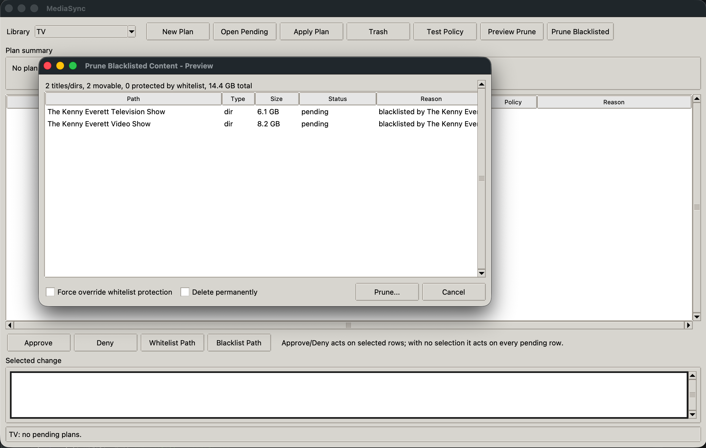

# mediasync

Media-aware, one-way sync for TV and movie libraries. `mediasync` compares a
source tree with a target tree, builds a reviewable plan, and applies only what
you approve. It never writes to the source.

It is designed for large SMB shares: scans run per title in parallel, unchanged
titles are cached by directory fingerprint, and rsync is used only for the
files that actually need work.

## Features

- One-way source to target sync; the source is opened read-only.
- Per-title parallel planning with a fingerprint cache for fast repeat scans.
- Whitelist and blacklist policy files with predictable precedence.
- Approval workflow for destructive changes, plus a cron-safe `run` command.
- Re-encode detection for media that changes extension, quality tag or size.
- Reviewable plans as terminal output, JSON and HTML.
- Target-side quarantine (`.mediasync-trash/`) for deletes and replaced files.
- Source sanity checks that abort if a mount disappears or a title count drops.
- tkinter GUI for reviewing plans, approving changes, editing policy and
  restoring from trash.
- Optional ffprobe metadata in plans.

## Requirements

- Python 3.11 or newer.
- A desktop Python build with tkinter for the GUI (the CLI does not need it).
- `rsync` 3.x on `PATH`.
- Optional: `ffprobe` for codec and resolution metadata.

On macOS with Homebrew:

```sh
brew install rsync
python3 --version
python3 -c "import tkinter"
```

## Install

```sh
python3 -m venv .venv
. .venv/bin/activate
pip install -e .
```

This installs the `mediasync` command. You can also run it without installing:

```sh
PYTHONPATH=src python3 -m mediasync --help
```

## Quick start

```sh
mkdir ~/mediasync-config
cd ~/mediasync-config
mediasync init
```

Edit `mediasync.toml` with your source and target paths, then validate:

```sh
mediasync config validate
mediasync config show
```

Create a plan without changing the target:

```sh
mediasync plan
```

Review the plan ID, then approve or deny changes:

```sh
mediasync show <plan-id>
mediasync approve <plan-id> --all
mediasync apply <plan-id>
```

Or create and apply in one step when the plan is safe:

```sh
mediasync run
```

`run` is intended for cron. It applies auto-approved changes and exits with a
distinct code when human approval is needed. It does not apply blocking changes
unless `--apply-safe` is given.

## Configuration

`mediasync init` creates a TOML file and policy templates:

```toml
state_dir = "~/.mediasync"
concurrency = 8
scan_mode = "fast"
trash_retention_days = 30
delete_mode = "trash"
require_mount = true
min_source_titles = 1
max_source_title_drop_pct = 20
report_html = true

[rsync]
modify_window = 2
fsync = true
timeout = 600
# extra_args = ["--bwlimit=50m"]

[apply]
auto_approve = [
  "add_title",
  "add_media",
  "add_sidecar",
  "update_sidecar",
  "delete_sidecar",
  "reencode",
]
max_pending_deletions = 0
max_delete_gb = 0
bulk_reencode_count = 5

[[libraries]]
name = "TV"
kind = "tv"
source = "/Volumes/Multimedia/TV"
target = "/Volumes/Media_UNAS/Dale/TV"
whitelist = "policy/tv-whitelist.txt"
blacklist = "policy/tv-blacklist.txt"

[[libraries]]
name = "Movies"
kind = "movies"
source = "/Volumes/Multimedia/Movies"
target = "/Volumes/Media_UNAS/Dale/Movies"
whitelist = "policy/movies-whitelist.txt"
blacklist = "policy/movies-blacklist.txt"
```

Relative paths in the config are resolved against the config file's directory.
Use a per-library `[libraries.rsync]` table to override any global rsync option
for one library.

Important settings:

| Setting | Meaning |
| --- | --- |
| `state_dir` | SQLite state, plans, reports and the lock file. |
| `concurrency` | Number of per-title rsync scans run at once (1-64). |
| `scan_mode` | `fast` uses the cache; `deep` rescans every title. |
| `modify_window` | rsync `--modify-window` seconds, default 2 for SMB. |
| `fsync` | Pass `--fsync` to rsync only when applying, never when scanning. |
| `timeout` | rsync/network timeout in seconds, default 600. Passed as `--timeout` to rsync and affects subprocess timeouts for scan/copy; increase for slow WAN/VPN links. |
| `delete_mode` | `trash` (default) or `permanent`. |
| `require_mount` | Refuse to run if source or target is the root filesystem. |
| `max_source_title_drop_pct` | Abort if the source loses more titles than this. |
| `report_html` | Write an HTML report for each plan. |

### Rsync options

`mediasync` always builds the safe base command:

```text
rsync -rlt --no-perms --no-owner --no-group --no-xattrs --no-acls
      --no-devices --no-specials --timeout N
      [--modify-window N] [--checksum] [--exclude PATTERN ...]
```

`--fsync` is added only to apply commands. Junk files such as `.DS_Store`,
`._*`, `@Recycle`, `#recycle`, `Thumbs.db`, `*.tmp` and partial downloads are
excluded by default.

`[rsync].timeout` sets the rsync `--timeout` (default 600s) and the subprocess
timeout for scan/copy operations. Increase it for slow WAN/VPN links. For
connection-specific timeouts you can pass `--contimeout` via `extra_args` (if
allowed).

`rsync.extra_args` is restricted to a small allowlist of long-form options:
`--bwlimit`, `--compress`, `--compress-level`, `--compress-choice`,
`--whole-file`, `--no-whole-file`, `--block-size`, `--checksum-choice`,
`--sparse`, `--preallocate`, `--no-motd`, `--contimeout`, `--sockopts`,
`--ipv4` and `--ipv6`. Flags that could change deletion or filtering behaviour
are rejected at config load time.

## Policy files

Rules are library-relative paths, one per line. Blank lines and lines starting
with `#` are ignored.

```text
# exact title or path prefix
Andor
Babylon 5/Season 1

# glob
*/Extras
*.iso

# regular expression, searched against the path
re:^Doctor Who/.*S0[1-9].*$
```

Precedence is based on specificity (length plus 100 per slash). The most
specific matching rule wins. If a whitelist and a blacklist rule have equal
specificity, the blacklist wins.

### When to use Whitelist vs Blacklist

- **Whitelist**: protects existing target content. Use when you want to keep something on the target even if it's removed from the source, or preserve manually curated files that don't exist in source. Updates, replacements, re-encodes and deletes of existing target content are held automatically.
- **Blacklist**: ignores the path entirely. Use when you never want something synced at all. Nothing is copied, updated or deleted for blacklisted paths.

#### Whitelist examples

1. **Archived show removed from source** - A show (e.g. `The West Wing`) is deleted from your source share to save space, but you want to keep it on your NAS for archival. Add `The West Wing` to your whitelist - mediasync will never delete it from the target.
2. **Manually curated extras** - You added director commentaries or custom subtitles to `Dune (2021)/Extras` on the target that don't exist on source. Add `Dune (2021)/Extras` to your whitelist so mediasync won't delete or modify them.

#### Blacklist examples

1. **Skip bonus content** - You never want `*/Extras` folders synced from source. Add `*/Extras` to your blacklist and mediasync will ignore them entirely.
2. **Skip unwanted formats** - You don't want ISO rips synced. Add `*.iso` to your blacklist so they're never copied over, even if they exist on source.

**Rule of thumb:** If you want to *preserve* something that exists on the target (especially if removed from source), use **whitelist**. If you want to *never sync* something from source, use **blacklist**.

Manage rules with the CLI or GUI:

```sh
mediasync policy list -l TV
mediasync policy test -l TV --path "Andor/Season 1"
mediasync policy add-whitelist -l TV "Andor"
mediasync policy add-blacklist -l TV "*/Extras"
mediasync policy remove -l TV "Andor" --kind whitelist
```

The GUI can whitelist or blacklist the selected plan paths directly.

## Approval workflow

A plan contains one change per file, or one title-level change when a whole
title is added or removed. Categories are:

`add_title`, `add_media`, `add_sidecar`, `update_sidecar`, `delete_sidecar`,
`replace_media`, `reencode`, `delete_media`, `delete_title`.

Changes in `apply.auto_approve` are accepted automatically. Everything else is
pending until approved. Pending deletions also produce blocking reasons based
on `max_pending_deletions` and `max_delete_gb`.

Useful commands:

```sh
mediasync pending
mediasync show <plan-id> --verbose
mediasync show <plan-id> --html
mediasync approve <plan-id> --all
mediasync deny <plan-id> --all
mediasync approve <plan-id> "Andor*" "Movies/Some Film*"
mediasync apply <plan-id>
```

When a plan is stale (source or target changed after planning), apply refuses
to run and exits with code 14. Create a new plan.

### Cron

```cron
15 3 * * * cd /Users/me/mediasync-config && /path/to/.venv/bin/mediasync run >> ~/.mediasync/cron.log 2>&1
```

`mediasync run` is designed for unattended/cron use:

- **It always creates a fresh plan.** `run` scans all enabled libraries and builds new plans (it does not require a pre-existing plan). If pending plans already exist for a library, `run` will skip that library unless `--force` is passed (which supersedes pending plans).
- **Auto-approval is respected.** Changes listed in `[apply].auto_approve` are accepted automatically when planning/applying. Other changes remain pending.
- **It applies what it can, stops for what it can't.** By default, if a plan has pending changes requiring approval or is blocked, `run` will *not* apply anything for that library and will exit with code `10` (approval required) or `11` (blocked). It still processes other libraries and writes a combined run report.
- **Use `--apply-safe` to apply only auto-approved changes.** With `--apply-safe`, `run` will apply accepted/auto-approved changes even if the plan requires approval for other items. Pending/held items that aren't auto-approved are not applied; the run still reports and exits with `10` if approval would otherwise be required.
- **Safety checks still apply.** Mount issues, source title drops, stale plans, locks, and blocking reasons (like exceeding `max_pending_deletions`/`max_delete_gb`) are enforced. Plans with scan errors cause exit code `4` for that library.
- **Reports are always written.** Each `run` writes a text run report and, by default, HTML reports for each plan it creates.

```sh
mediasync run --apply-safe  # Apply only auto-approved changes, skip libraries that need manual approval
```

## Trash

With `delete_mode = "trash"` (the default), removed titles, removed files and
replaced media are moved under the target library:

```text
<target>/.mediasync-trash/<run-id>/deleted/...
<target>/.mediasync-trash/<run-id>/backups/...
```

Trash is tracked in SQLite. Restore or purge it with:

```sh
mediasync trash list
mediasync trash list --library TV --json
mediasync trash restore --library TV --id 12
mediasync trash restore --library TV --id 12 --overwrite
mediasync trash purge --library TV --older-than 30
mediasync trash purge --library TV --all --yes
```

The GUI trash browser supports restore and purge. Purging is permanent.

## GUI

```sh
mediasync gui
mediasync gui --library Movies
```

The GUI can create plans in the background, open pending plans, approve or deny
selected rows, add whitelist/blacklist rules, test policy matches, inspect
changes, apply approved plans, and browse trash.

## Exit codes

| Code | Meaning |
| --- | --- |
| 0 | Success. |
| 2 | Usage or configuration error. |
| 3 | Safety check failed. |
| 4 | Plan contains scan errors. |
| 10 | Approval required; nothing applied. |
| 11 | Blocked by policy or bulk guard. |
| 12 | Apply failure or partial apply. |
| 13 | Another mediasync process holds the lock. |
| 14 | Plan is stale; create a new plan. |
| 130 | Interrupted with Ctrl-C. |

## Safety model

- The source is only read. All writes are under the target library root.
- Source and target must exist, be directories, and must not overlap.
- With `require_mount`, the root filesystem is rejected for both sides.
- A source title-count drop or an unexpectedly empty target aborts the scan.
- Plans record directory fingerprints; apply re-checks them before writing.
- Per-file copies are verified for size and mtime.
- A lock file prevents concurrent plans or applies for the same state dir.
- Deletions are path-validated under the target root and go to trash by default.
- rsync is invoked with an explicit argument allowlist and without archive-mode
  permissions or ownership.

## Performance

TV and movie libraries are scanned one title at a time, in parallel, so a slow
SMB directory does not block the rest of the scan. With the default `fast` mode,
a title whose source and target fingerprints are unchanged is skipped entirely
on the next plan. Use `mediasync plan --deep` (or `scan_mode = "deep"`) when you
want a full re-check.

`--modify-window=2` avoids false updates caused by SMB timestamp rounding.
`--checksum` is available but much slower on network shares.

## Development

The tests use only the Python standard library:

```sh
PYTHONPATH=src python3 -m unittest discover -s tests -v
```

Lint and formatting (optional):

```sh
pip install -e ".[dev]"
ruff check src tests
```

### Per-file policy behavior

- When a new title appears in source and parts are blacklisted, only non-blacklisted files are copied (`add_title` may carry `allowed_paths`); blacklisted subpaths are never transferred.
- When a title exists only in target and whitelist/blacklist rules apply, policy is evaluated per file: whitelisted target files are held (`HELD`), blacklisted target files are ignored/skipped, others become per-file `DELETE` changes (subject to approval).
- Title-level whitelist matches skip expansion into file deletes (content is protected). Title-level blacklist matches skip title entirely.

### Cache invalidation

- `fast` planning uses `tree_fingerprint` (names, sizes, mtimes, types) with a SHA256 digest (`source_digest`/`target_digest`). If digests/counts differ, the cache is not treated as clean even if `max_mtime` appears unchanged (nested file changes are detected).
- `scan_mode = "deep"` forces a full re-scan regardless of cache.

## CLI Examples

### Setup and configuration

```sh
# Create example config and policy files
mediasync init --path mediasync.toml

# Validate configuration
mediasync config validate

# Show effective configuration
mediasync config show
```

### Planning and applying

```sh
# Create a plan for all enabled libraries
mediasync plan

# Create a plan for a specific library with HTML report
mediasync plan --library TV --html

# Force a deep scan (ignore cache)
mediasync plan --deep

# Approve/deny changes
mediasync approve <plan-id> --all
mediasync deny <plan-id> Show.Name

# Apply an approved plan
mediasync apply <plan-id>
```

### Cron-safe runs

```sh
# Plan and apply auto-approved changes; exit 10 if approval needed
mediasync run

# Apply only auto-approved/safe changes even if others need approval
mediasync run --apply-safe

# Run for a single library
mediasync run --library Movies
```

### Policy management

```sh
# List policy rules
mediasync policy list --library TV

# Test a path against policy
mediasync policy test --library TV --path "Show Name/Extras/clip.mkv"

# Add patterns
mediasync policy add-whitelist --library TV "Archived Show"
mediasync policy add-blacklist --library TV "*/Extras"

# Remove a pattern
mediasync policy remove --library TV "Old Show"
```

### Trash operations

```sh
# List all trash
mediasync trash list

# List trash for a specific library
mediasync trash list --library TV

# Restore an entry
mediasync trash restore --library TV --id 123

# Purge entries older than retention days (requires --yes)
mediasync trash purge --library TV --yes

# Purge a specific entry permanently
mediasync trash purge --library TV --id 123 --yes
```

### Prune blacklisted content

```sh
# Preview what would be pruned
mediasync prune-blacklisted --library TV --dry-run

# Prune (moves to trash by default)
mediasync prune-blacklisted --library TV --yes

# Prune permanently (dangerous)
mediasync prune-blacklisted --library TV --yes --permanent
```

### GUI

```sh
# Launch GUI for all libraries
mediasync gui

# Launch GUI focused on a specific library
mediasync gui --library TV
```

## Screenshots

| Screenshot | Description |
| --- | --- |
|  | Main GUI with library selection, plan controls, and status. |
|  | Review changes, actions, and approve/deny individually or in bulk. |
|  | Test whitelist/blacklist rules against library-relative paths. |
|  | Browse top-level titles from source/target and add to whitelist/blacklist. |
|  | Trash with library filtering and multi-select restore/purge. |
|  | Preview blacklisted content before pruning to trash. |
